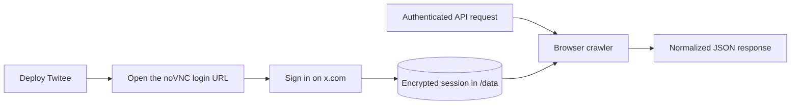

# Twitee

[](https://github.com/nohuman-labs/twitee/actions/workflows/ci.yml)
[](LICENSE)


Twitee turns a real browser session into a small, self-hosted JSON API for X. Its core is a capability-protected noVNC login: Twitee launches a visible browser, you sign in to X inside that browser, and Twitee saves the session for later API requests.

Twitee crawls the website a person sees in a browser. It does not use the official X API, ask for your X password, or depend on a database, worker, or job queue.

## How it works



1. Twitee starts a browser and a small HTTP API.
2. `POST /v1/session/login` returns a short-lived noVNC URL. You sign in on the real X page shown there.
3. Twitee saves the resulting browser session as AES-256-GCM encrypted data on the Docker volume.
4. Each API request opens an isolated browser context with that session, reads X, returns normalized JSON, and closes the context.

One instance uses one X account and runs one crawl at a time. Up to ten requests can wait in memory; each request has a 60-second deadline.

> [!WARNING]
> Browser automation can break when X changes its site and may be subject to X's terms and local law. Use an account and data you are authorized to access. Twitee is not affiliated with X Corp.

## Quick start

You need Docker with Compose v2.

### 1. Clone the repository

```bash
git clone https://github.com/nohuman-labs/twitee.git
cd twitee
cp .env.example .env
```

### 2. Create your local keys

Run this command twice:

```bash
openssl rand -hex 32
```

It prints a new random value each time. Open `.env` and paste the first value after `TWITEE_API_KEY=` and the second value after `TWITEE_ENCRYPTION_KEY=`:

```dotenv
TWITEE_API_KEY=your-first-generated-value
TWITEE_ENCRYPTION_KEY=your-second-generated-value
TWITEE_NOVNC_URL=http://127.0.0.1:6080
```

`TWITEE_API_KEY` protects the Twitee API. It is created by you and is unrelated to your X account. `TWITEE_ENCRYPTION_KEY` encrypts the saved X browser session. Keep both values private.

### 3. Start Twitee

```bash
docker compose up --build -d
curl http://127.0.0.1:8080/healthz
```

A healthy process returns:

```json
{"ok":true,"service":"twitee"}
```

Docker Compose reads the keys from `.env` automatically.

### 4. Start a noVNC login session

Load the same API key into your current shell:

```bash
. ./.env
```

Now ask Twitee to launch the login browser:

```bash
curl -X POST \
  -H "Authorization: Bearer $TWITEE_API_KEY" \
  http://127.0.0.1:8080/v1/session/login
```

This command does not log in to X. It starts a visible browser inside the Twitee container and returns a response like this:

```json
{
  "ok": true,
  "data": {
    "status": "login_pending",
    "expires_at": "2026-09-09T12:10:00.000Z",
    "no_vnc_url": "http://127.0.0.1:6080?capability=..."
  },
  "next_cursor": null,
  "error": null
}
```

### 5. Open noVNC and sign in to X

Copy the complete `no_vnc_url` from the response and open it in your normal web browser. noVNC connects you to the browser running inside Twitee, which is already showing the X login page.

Sign in on that X page. Your username, password, and any login challenge are entered directly into X inside the noVNC browser; they are not sent to the Twitee API.

The noVNC URL expires after ten minutes. When the browser reaches `x.com/home`, Twitee verifies the session, encrypts it on the Docker volume, and closes the login browser. The noVNC window disconnecting at this point is expected.

### 6. Check that the session is ready

Run:

```bash
curl -H "Authorization: Bearer $TWITEE_API_KEY" \
  http://127.0.0.1:8080/v1/session
```

Continue when the response contains:

```json
{
  "ok": true,
  "data": {
    "status": "ready",
    "startedAt": "2026-09-09T12:00:00.000Z",
    "expiresAt": null,
    "readyAt": "2026-09-09T12:02:00.000Z",
    "error": null
  },
  "next_cursor": null,
  "error": null
}
```

### 7. Make your first crawler request

```bash
curl -H "Authorization: Bearer $TWITEE_API_KEY" \
  http://127.0.0.1:8080/v1/profiles/openai
```

Every `/v1/*` endpoint returns the same envelope:

```json
{
  "ok": true,
  "data": {
    "handle": "openai",
    "displayName": "OpenAI",
    "availabilityStatus": "available"
  },
  "next_cursor": null,
  "error": null
}
```

## API

All `/v1/*` routes require `Authorization: Bearer <TWITEE_API_KEY>`.

| Method | Route | Result |
| --- | --- | --- |
| `POST` | `/v1/session/login` | Start interactive X login |
| `GET` | `/v1/session` | Read session status |
| `DELETE` | `/v1/session` | Delete the stored session |
| `GET` | `/v1/profiles/:handle` | Get a profile |
| `GET` | `/v1/profiles/:handle/posts` | List profile posts |
| `GET` | `/v1/posts/:handle/:postId` | Get one post |
| `GET` | `/v1/search/posts?q=...` | Search latest posts |
| `GET` | `/v1/search/people?q=...` | Search accounts |

Profile-post and search responses may include `next_cursor`. Pass it back unchanged as the `cursor` query parameter to fetch the next page.

See the complete request, response, and error schemas in [openapi.yaml](openapi.yaml). More curl examples are in [examples/curl.sh](examples/curl.sh).

## Deployment and security

Docker Compose binds the API and noVNC ports to `127.0.0.1` by default:

| Port | Purpose | Exposure |
| --- | --- | --- |
| `8080` | JSON API | Keep private or place behind authenticated TLS |
| `6080` | Interactive login | Keep private; never expose directly to the internet |

For a remote deployment, put both ports behind a trusted TLS reverse proxy and network-level access control. Set `TWITEE_NOVNC_URL` to the external HTTPS address used for port `6080`.

The `twitee-data` volume contains the encrypted X session and browser cache. Keep `TWITEE_ENCRYPTION_KEY` stable and store it separately from the volume. Losing or changing the key makes the session unreadable and requires another login.

The noVNC URL contains a random capability rather than your API key. Raw VNC and websockify remain bound to loopback inside the container. Login profiles use temporary storage and are removed after the browser closes.

Read [authentication and session storage](docs/authentication.md) before deploying outside a local machine. Operational details are in [architecture](docs/architecture.md) and [troubleshooting](docs/troubleshooting.md).

## Tech stack

- Node.js 22 and TypeScript
- CloakBrowser and Playwright Core
- Native Node.js HTTP, crypto, and filesystem APIs
- Zod for input validation and Pino for redacted logs
- Xvfb, Fluxbox, x11vnc, noVNC, and websockify for interactive login
- Docker, Docker Compose, and Vitest

Linux `amd64` and `arm64` are supported.

## Limits

- One X account and one active crawl per instance
- No durable jobs; callers wait for the HTTP response
- No official X API compatibility layer
- X can impose login challenges, account locks, or rate limits
- Site changes can require parser updates

## Development

```bash
npm ci
npm run typecheck
npm test
npm run build
docker build -t twitee:dev .
```

Tests use sanitized fixtures and never log in to X. Live-X verification is manual because it needs an account and may encounter account-specific challenges.

Contributions are welcome. Read [CONTRIBUTING.md](CONTRIBUTING.md) and report security issues through GitHub's private vulnerability reporting flow described in [SECURITY.md](SECURITY.md).

## License

[MIT](LICENSE)
